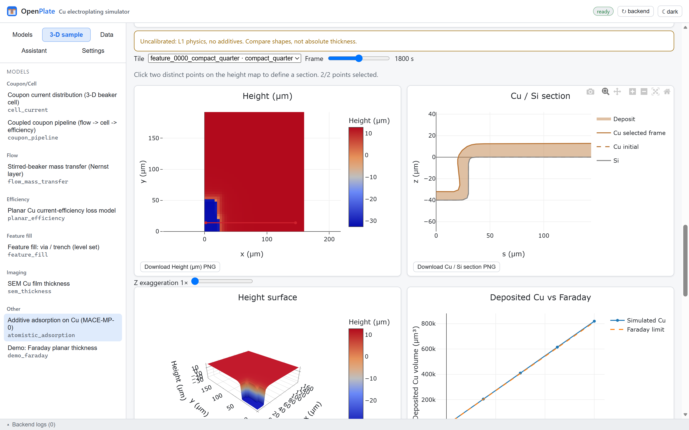
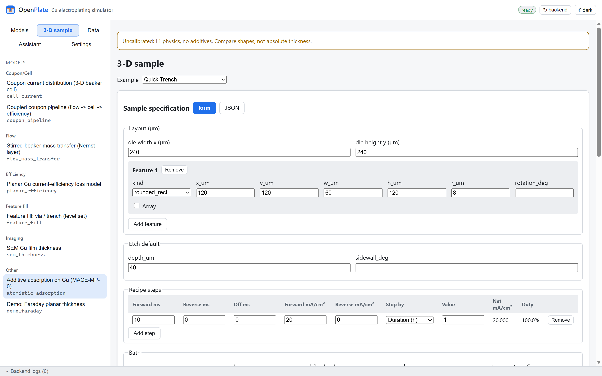
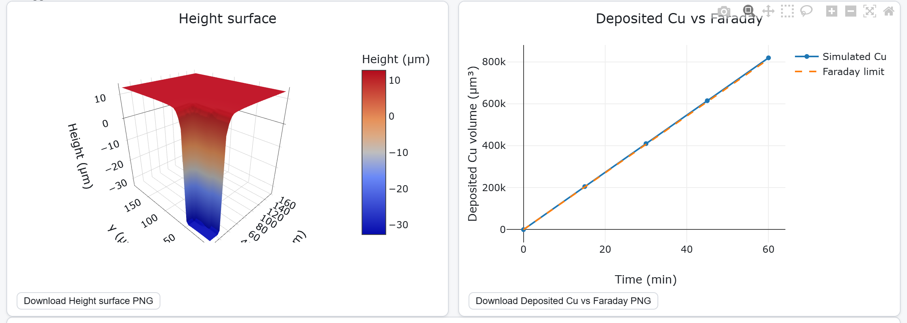
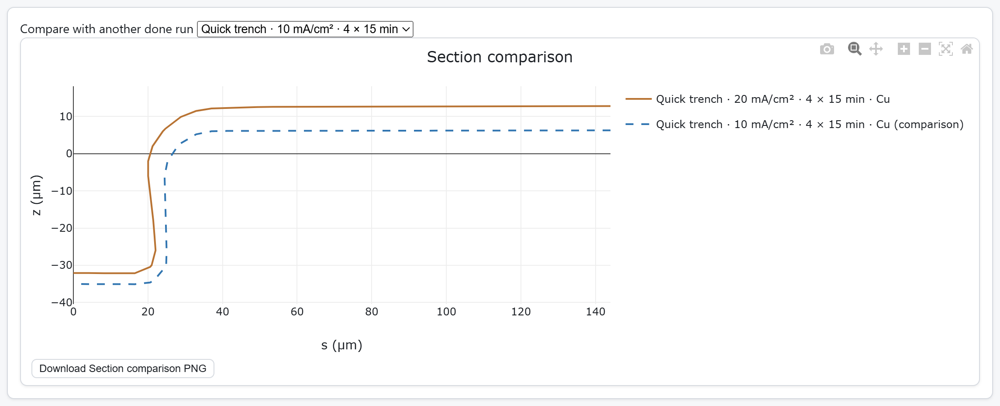

<p align="center">
  <picture>
    <source media="(prefers-color-scheme: dark)" srcset="docs/brand/openplate-wordmark-dark.svg">
    
  </picture>
</p>

<p align="center">
  <b>An open-source, scriptable simulator for copper electroplating, from the beaker down to a single trench.</b><br>
  Python models · FastAPI server · Electron/React desktop app · agent (MCP) interface
</p>

<p align="center">
  
</p>

OpenPlate models copper electroplating from the beaker scale down to a single via or trench. Every model is a
plug-in with the same small interface, so you can run it from Python, from a FastAPI server, from the
desktop app (Electron + React + Plotly) or from an LLM agent. It was inspired by COMSOL's electroplating module.

> **Status: research code.** Several models are validated against experiments; others are early (see the tables
> below). The 3-D sample simulator is **uncalibrated**: L1 physics, no additives. Compare shapes, not absolute
> thickness.

## 3-D sample simulator

Describe a die (layout, etch depth, pulse-reverse recipe, bath, setup), and OpenPlate picks representative 3-D
tiles, plates them with a level-set front and reports field, floor and wall thickness, fill fraction and voids.

<table>
  <tr>
    <td width="50%"></td>
    <td width="50%"></td>
  </tr>
  <tr>
    <td><b>Specify.</b> Start from a synthetic example or the form (or raw JSON). Import GDS, DXF or image layouts;
      polygons are fitted to editable shapes, and anything that does not fit is listed rather than dropped.</td>
    <td><b>Inspect.</b> Height maps, 3-D surfaces with Z exaggeration, and a frame slider over the
      recipe steps.</td>
  </tr>
  <tr>
    <td></td>
    <td></td>
  </tr>
  <tr>
    <td><b>Cut.</b> Click two points on the height map for a Cu/Si cross-section at any frame.</td>
    <td><b>Compare.</b> Overlay another run on the same cut; download CSV, STL and PNG.</td>
  </tr>
</table>

What it does:

- **Tiling.** Arrays use one (mirrored) pitch cell; long trenches use a mid-length profile tile plus an end tile;
  compact features use a quarter tile. Each plan lists its tiles, cell counts and a time estimate before you run.
- **Physics (L1).** Quasi-steady Cu²⁺ diffusion (with an acid-migration enhancement factor) and electrolyte
  potential below a Nernst-layer bulk plane, cathodic Tafel kinetics under a galvanostatic constraint, and a
  level-set growth front on a cell-centred grid with multigrid/AMG solvers. By default pulse-reverse recipes
  enter through their net current.
- **Cycle-resolved pulse-reverse (opt-in).** `numerics.pulse_model: "resolved"` (or `run_tile(pulse=...)`)
  solves the forward (cathodic), reverse (anodic) and off phases on the frozen surface, with a per-cell
  pulsating diffusion layer and optional double-layer charging (`Params.C_dl_F_cm2`). In a study with a
  9/0.5/0.5 ms waveform at 15 mA/cm2 and no additives (`tools/pulse_roughness.py`), the model shows no
  leveling of 3-48 um surface waviness and changes trench floor/field by about 0.01. Effects outside the
  model (additive kinetics, nucleation and grain refinement) are the candidates for the smoothing seen in
  practice; other waveforms and currents near the limiting current are not yet tested.
- **Coupon position (optional).** `setup.coupon_position_cm` takes the local current, Nernst layer and
  efficiency from the calibrated coupon model instead of the coupon mean.
- **Optional resolved stirring (experimental).** `setup.stir_shear_1_s` adds a Stokes shear flow over the
  feature; it uses full periodic tiles and runs about 20× slower.
- **Additives (engine API only, uncalibrated).** `run_tile` supports `Params.additives='cl_ndr'` (chloride and
  suppressor coverage), `'acc'` (plus a transported accelerator) and `kinetics_factor=` (a prescribed
  exchange-current map); the sample spec and UI do not expose them yet.
- **Not modelled yet.** CEAC curvature effects, seed thinning, buoyancy in sample runs, die-edge effects. These spec fields are
  accepted, marked in the UI, and ignored.

The Quick Trench example (60 × 120 µm, 40 µm deep, 20 mA/cm² for 1 h) runs in about a minute on a laptop CPU at
the default 8 µm grid. The screenshots use a 4 µm grid in four 15-minute steps (several minutes per run).

Agents can drive the same engine through `platesim.mcp3d` (see [platesim/mcp3d/README.md](platesim/mcp3d/README.md)),
and the CLI is `python -m platesim.sample3d plan|run spec.json` (see
[platesim/sample3d/README.md](platesim/sample3d/README.md)). The spec, manifest and HTTP API are defined in
[CONTRACTS_3D.md](CONTRACTS_3D.md).

## What it models

### 3-D engine

| package | what it does |
|---|---|
| `platesim.spec3d` | pydantic sample spec and result manifest, plus synthetic examples |
| `platesim.layout` | parametric, GDS, DXF and image layout import; shape fitting; rasterising and etch geometry |
| `platesim.tile3d` | cell-centred 3-D tile engine: potential and Cu transport, level-set front, MG/AMG and ILU solvers |
| `platesim.flow3d` | Stokes flow (shear and buoyancy) on the same grid |
| `platesim.sample3d` | spec → tile plan → runs → manifest pipeline |
| `platesim.analysis3d` | height and thickness maps, cross-sections, feature and void reports, STL export |
| `platesim.render3d` | headless surface, height-map and section rendering |
| `platesim.mcp3d` | agent interface (MCP server) for isolated runs |

Faraday and Cu-balance checks are reported with every run. Cross-checks against the 2-D engine are in `tools/`.
Solver performance: LU factors are reused as Krylov preconditioners across outer iterations and the level-set
WENO kernels run in numba (`tools/bench_tile3d.py` benchmarks both; sheared trench tiles are about 3x faster
than before). A Rust/PyO3 kernel spike (branch `spike/rust-kernels`) found no worthwhile gain over parallel numba.

### Beaker, coupon and feature models

| id | package | what it does | status |
|---|---|---|---|
| `cell_current` | `platesim.cell` | 3-D beaker current distribution (gmsh + scikit-fem, Butler-Volmer + Nernst layer, galvanostatic). Coupon current density and thickness maps, overpotential decomposition, Wagner number, current lost to the back and edges | charge conservation to 1e-7; duct potential checked against analytic solution |
| `flow_mass_transfer` | `platesim.flow` | Nernst layer on the coupon: rotation correlation, or a 2-D lattice-Boltzmann slice + Leveque | LBM Poiseuille error < 2 %; Reynolds-number extrapolation is order-of-magnitude only |
| `planar_efficiency` | `platesim.efficiency` | lumped loss model (stray current, CC to CV fallback, O2 reduction, start-up loss) with MAP/MCMC calibration of competing hypotheses | calibrated to a planar DOE (data not included) |
| `coupon_pipeline` | `platesim.coupon` | flow, current and efficiency coupled and calibrated jointly to DOE and SEM points | see `platesim/coupon/validation.json` |
| `feature_fill` | `platesim.feature` | level-set superfilling (S-NDR) fill of one via (axisymmetric) or trench (2-D Cartesian) | Faraday limit within 0.03 % in trench test |
| `sem_thickness` | `platesim.imaging` | pixel size from SEM image metadata and automatic Cu thickness measurement | within 3-5 % of manual measurements |
| `atomistic_adsorption` | `platesim.atomistic` | MACE-MP-0 adsorption energies for Cl, thiolate, H2O and ethers on Cu(100)/(111); separate venv | trends only (see `platesim/atomistic/NOTES.md`) |
| `trenchflow` | `platesim.trenchflow` | trench fill transport with LBM cavity flow and particle transport | convergence studies in `platesim/trenchflow/` |
| `demo_faraday` | `platesim.demo` | Faraday thickness, end-to-end test model | |

Literature parameter sets (digitised and cited, DOIs checked) live in `platesim/data/literature/`.
Each number in the code is tagged with its source: `[FT]` full text, `[AB]` abstract, `[SH]` secondhand,
`[C]` calculated, `[J]` judgement or calibration target, `[M]` measured.

## Install

Requires Python 3.11 or newer.

```bash
git clone https://github.com/EkagraAgarwal/openplate.git
cd openplate
python -m venv .venv && source .venv/bin/activate     # Windows: .venv\Scripts\activate
pip install -e ".[fast,ref,layout,viz,spec]"          # extras needed by the 3-D simulator
```

Or with [uv](https://docs.astral.sh/uv/), which needs no manual venv:

```bash
uv run --project . --extra fast --extra ref --extra layout --extra viz --extra spec python -m platesim.server --port 8765
```

Extras: `fast` (numba), `ref` (pyamg), `layout` (gdstk, ezdxf, shapely), `viz` (pyvista, matplotlib, imageio),
`spec` (pydantic, typer).

## Run

Build the UI once, then start the server and open the browser:

```bash
cd app && npm install && npm run build && cd ..
python -m platesim.server --port 8765
# open http://127.0.0.1:8765/ and pick 3-D sample → Quick Trench
```

Desktop app:

```bash
cd app && npm install && npm run build && npm start
```

The desktop app starts its own backend. `npm run dev:mock` runs the UI without Python.
If `python` is not on PATH (or Settings → Python is set to `uv`), it runs the backend with
`uv run --project . --extra fast --extra ref --extra layout --extra viz --extra spec`.

## Tests

```bash
python -m pytest tests -m "not slow"      # fast suite
python -m pytest tests                    # includes long validation runs (about 3 min+)
cd app && npm test                        # desktop UI tests
```

Some tests and calibrations read experimental datasets (team DOE and SEM measurements). Those files are not in
this repository, so the affected tests will fail until you supply your own data in the same format.

## Writing a model plug-in

Each model package exposes a `MODEL_SPEC` dictionary and a `run(params, progress)` function. The server discovers
them automatically and the UI builds the input form from `params`. See [CONTRACTS.md](CONTRACTS.md) for the
full interface, units convention and output schema.

```python
MODEL_SPEC = {
    "id": "my_model",
    "title": "My model",
    "description": "...",
    "params": [{"name": "I_total_mA", "type": "float", "default": 48.0, "min": 0.1, "max": 500, "unit": "mA"}],
}

def run(params: dict, progress=lambda frac, msg="": None) -> dict:
    return {"summary": {...}, "plots": [...], "warnings": [], "assumptions": []}
```

Units inside the code are cm, s, mol, A, V and K. Suffixes such as `_um`, `_mA_cm2` and `_min` mark other units.

## Configuration

- `PLATESIM_RESEARCH_DIR` (optional): path to a private reference engine used by one regression check in
  `platesim/feature/validate_trench.py`. Unset means that check is skipped.

## Repository layout

```
platesim/        Python package: models, 3-D engine, server, shared data
app/             Desktop and web UI (Electron, Vite, React, Plotly)
tests/           pytest suites for the Python models and server
tools/           benchmarks and 3-D vs 2-D cross-check scripts
docs/            brand assets and screenshots
CONTRACTS.md     Model plug-in interface and conventions
CONTRACTS_3D.md  3-D spec, manifest, HTTP API and agent interface
```

## Contributing

### Running the tests

Run `bash tools/ci_local.sh` (Git Bash on Windows) for the public Python tests,
app tests and TypeScript checks. It installs the Python extras and uses a fresh
writable pytest temp directory; override its parent with `CI_TEMP_ROOT`.
Tests needing absent private measured data skip with the missing filename.
For the full Python suite, use the same `uv run` command in the script without
`-m "not slow and not gpu"`; the public quick-trench golden takes about 95 s.

Issues and pull requests are welcome. For a new model, follow the plug-in contract above and add tests in
`tests/test_<module>.py`. Please tag every literature value with its source and do not commit personal data.

## License

MIT. See [LICENSE](LICENSE).
